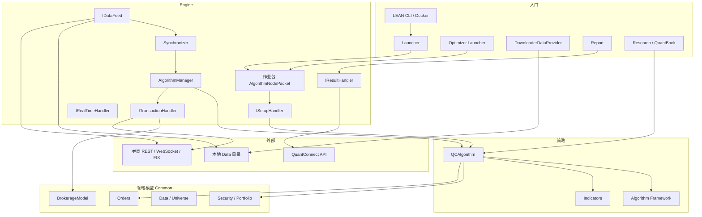

# LEAN 架构方案

本文基于当前仓库源码，说明 QuantConnect LEAN（Lean Algorithmic Trading Engine）的系统结构、一次作业如何跑完，以及哪些边界可以替换。它描述的是引擎本身，不替代 [QuantConnect 产品文档](https://www.quantconnect.com/docs)。

## 1. 系统定位

LEAN 是事件驱动的多资产算法交易引擎。同一份策略代码可以跑回测、模拟盘和实盘。策略看到的是时间片上的行情、持仓和订单事件；数据从哪来、订单交给谁成交，由配置里的处理器决定。

设计上有四条硬约束：

- **回测与实盘共用事件模型。** `AlgorithmManager` 对每个时间片执行同一套步骤。差别在数据源、时钟和成交实现。
- **基础设施外置。** 初始化、行情、成交、实时事件、结果输出都是可替换接口，由 `config.json` 的 `environment` 装配。
- **市场规则下沉到模型。** 手续费、滑点、成交、保证金、结算、期权定价不写进策略主流程，挂在 `Security` 和 `IBrokerageModel` 上。
- **C# 与 Python 共用引擎。** 算法工厂加载 C# 程序集或 Python 脚本；Python 通过 Python.NET 进入同一套 `QCAlgorithm` API。

## 2. 逻辑架构

一次作业的控制面和数据面分开：

| 面 | 容器 | 职责 |
| --- | --- | --- |
| 系统面 | `LeanEngineSystemHandlers` | 作业队列、消息通知、QuantConnect API、Lean Manager |
| 算法面 | `LeanEngineAlgorithmHandlers` | 初始化、数据、成交、实时事件、结果、映射/复权文件、对象存储、数据权限 |

`Launcher` 只负责把这两套处理器装起来，然后把作业交给 `Engine.Run`。

## 3. 解决方案分层

解决方案 `QuantConnect.Lean.sln` 按依赖从下到上分成四层。上层可以依赖下层，策略代码不应反向依赖某个券商协议。

| 层 | 项目 | 职责 |
| --- | --- | --- |
| 领域内核 | `Common` | 证券、订单、数据、统计、券商模型接口、优化目标等共享类型 |
| 计算库 | `Indicators` | 技术指标与 K 线形态 |
| 策略运行时 | `Algorithm`、`Algorithm.Framework` | `QCAlgorithm` 与五段式框架的默认模型 |
| 引擎 | `Engine` | 作业生命周期、数据同步、时间循环、回测/实盘处理器 |
| 适配 | `Brokerages`、`Api`、`Queues`、`Messaging`、`Logging`、`Configuration`、`Compression` | 券商连接基类、云 API、本地作业队列、日志与配置 |
| 算法产物 | `Algorithm.CSharp`、`Algorithm.Python`、`AlgorithmFactory` | 示例与回归算法，以及 C#/Python 实例化 |
| 外围进程 | `Launcher`、`Optimizer`、`Optimizer.Launcher`、`Report`、`Research`、`ToolBox`、`DownloaderDataProvider` | 回测/实盘入口、参数搜索、绩效报告、研究笔记本、数据工具 |
| 验证 | `Tests` | 单元测试、回归算法、券商模型测试 |

`Brokerages` 项目里主要是回测券商、模拟盘和 WebSocket 基类。Interactive Brokers、Binance、Alpaca 等实盘实现以独立程序集接入，本仓库通过 `BrokerageName`、`IBrokerageModel` 和 `config.json` 的 environment 引用它们。

## 4. 一次作业怎么跑

入口是 `Launcher/Program.cs`。

1. 解析命令行，与 `Launcher/config.json` 合并。先读顶层键，再用 `environment` 覆盖同名键。
2. `Initializer.Start()` 初始化日志。
3. `JobQueue.NextJob` 取出作业包，本地运行时通常就是当前配置描述的那一个算法。
4. 按配置创建算法处理器。
5. `Engine.Run` 跑完这一次回测或实盘，结束后退出。

`Engine.Run`（`Engine/Engine.cs`）的装配顺序是固定的，后面的组件依赖前面已经放好的状态：

1. 初始化结果处理器，并开始接收状态消息。
2. 读取市场交易时间数据库。算法构造函数就会用到它。
3. `Setup.CreateAlgorithmInstance` 创建 `IAlgorithm`。C# 来自程序集里的类型名，Python 来自脚本路径。
4. 初始化对象存储和数据权限。
5. 把成交处理器设到 `algorithm.Transactions`，再创建 `IBrokerage`。券商可能在初始化时就要查订单。
6. 用市场时间、合约属性和算法上的模型，构造 `SecurityService`。
7. 创建 `DataManager` 和 `UniverseSelection`，交给订阅管理器。
8. 实盘用 `LiveSynchronizer`，回测用 `Synchronizer`。
9. 初始化数据源，使它可以拦住随后新增的证券和股票池。
10. 初始化历史数据提供者，并挂到算法上。实盘默认关闭并行历史请求。
11. `Setup.Setup` 执行用户的 `Initialize()`，锁定算法状态。
12. 启动数据流、实时事件和成交处理。
13. `AlgorithmManager.Run` 消费时间片，直到结束、取消或组合净值为零。
14. 触发 `OnEndOfAlgorithm`，写出最终结果，释放券商和数据源。

回测在组合净值小于等于零时直接停止。实盘在状态变为 `Liquidated` 时才会调用 `Liquidate()` 平仓。

## 5. 时间片主循环

`AlgorithmManager` 不拉取行情。它只消费同步器吐出的 `TimeSlice`。每个切片代表“到这一时刻，所有订阅上已经对齐的数据”。

单个切片里的顺序：

1. 检查算法状态和取消标记。用时间桶限制单步耗时，避免用户代码卡死整次作业。
2. 补放因当时没有数据而错过的计划任务，再扫描过期的合成器（consolidator）。
3. `algorithm.SetDateTime`。如果这个切片只是时间脉冲，用来把时钟推到预热结束，则不再往下走。
4. 处理证券增减，更新价格、成交构造器和未结算资金。利息与结算按小时扫描。
5. 处理除权除息、拆股、退市。拆股和退市先给用户回调，再改内部持仓。
6. 有行情时调用 `OnData`。无论有没有行情，都调用 `OnFrameworkData`，让股票池在换日时仍能刷新。
7. 同步处理订单成交和结果采样。
8. `OnEndOfTimeStep`。

预热结束时，结果处理器先记下当时的组合净值，然后才调用用户的 `OnWarmupFinished`。这样预热阶段的交易不会污染回测起点。

实盘与回测在这一层的差异只剩三处：时钟用真实时间还是数据时间；同步器是否等待实时队列；成交是模型撮合还是券商回报。

## 6. 可插拔处理器

`Launcher/config.json` 用类型名装配处理器。默认 `environment` 是 `backtesting`。同一文件里还定义了 `live-paper` 以及各券商实盘环境。

| 处理器 | 回测实现 | 实盘实现 | 作用 |
| --- | --- | --- | --- |
| Setup | `BacktestingSetupHandler` | `BrokerageSetupHandler` | 创建算法、设置资金和起止时间，实盘还要与券商账户对齐 |
| Data feed | `FileSystemDataFeed` | `LiveTradingDataFeed` | 从磁盘文件或实时队列产生订阅数据 |
| Transaction | `BacktestingTransactionHandler` | `BrokerageTransactionHandler` | 用成交模型撮合，或把订单提交到券商 |
| Real time | `BacktestingRealTimeHandler` | `LiveTradingRealTimeHandler` | 用模拟时钟或真实时钟触发计划事件 |
| Result | `BacktestingResultHandler` | `LiveTradingResultHandler` | 采样权益、订单、图表，并对外发送 |
| History | `SubscriptionDataReaderHistoryProvider` | 通常再叠加 `BrokerageHistoryProvider` | 历史请求。实盘优先问券商，不足时读本地文件 |

模拟盘 `live-paper` 是混合形态：数据走实时队列，成交仍用回测成交处理器和 `PaperBrokerage`。它验证的是实时数据下的策略行为，不验证券商回报。

本地默认的其他插件：

- 日志：`CompositeLogHandler`
- 作业队列：`QuantConnect.Queues.JobQueue`
- 云 API：`QuantConnect.Api.Api`
- 代码映射与复权：本地磁盘上的 map / factor file provider
- 数据文件：`DefaultDataProvider`
- 对象存储：`LocalObjectStore`
- 行情聚合：`AggregationManager`

云端部署可以换掉队列、结果和数据提供者，引擎循环不用改。

## 7. 策略运行时

### 7.1 QCAlgorithm

`Algorithm/QCAlgorithm` 按文件拆开，但对外是一个类：

| 文件 | 能力 |
| --- | --- |
| `QCAlgorithm.cs` | 生命周期、证券集合、组合、调度、参数、日志 |
| `QCAlgorithm.Trading.cs` | 下单、改单、撤单、条件单 |
| `QCAlgorithm.History.cs` | 历史数据请求 |
| `QCAlgorithm.Universe.cs` | 股票池与宇宙过滤 |
| `QCAlgorithm.Indicators.cs` | 指标注册与自动预热 |
| `QCAlgorithm.Plotting.cs` | 图表 |
| `QCAlgorithm.Framework.cs` | 五段式框架编排 |
| `QCAlgorithm.Python.cs` | Python 互操作 |

用户策略至少实现 `Initialize` 和 `OnData`。也可以实现 `OnSecuritiesChanged`、`OnOrderEvent`、`OnSplits`、`OnDividends`、`OnDelistings`、`OnEndOfAlgorithm`，以及按自定义数据类型重载的 `OnData`。

### 7.2 算法框架

框架把“选什么、看多看空、目标仓位、风险削减、怎么下单”拆成五个模型。`OnFrameworkData` 的调用顺序是：

1. 到达刷新时间时，`IUniverseSelectionModel` 重建股票池。
2. `InsightManager` 推进观点的生命周期。
3. 当前切片有数据时，`IAlphaModel.Update` 产生 `Insight`。
4. `IPortfolioConstructionModel` 把观点变成 `IPortfolioTarget`。
5. `IRiskManagementModel` 可以按标的覆盖目标仓位。
6. `IExecutionModel` 按调整后的目标下单。

证券增减会同时通知 Alpha、组合构建、执行和风控。默认实现放在 `Algorithm.Framework`：

- 选股：粗选/精细基本面、ETF 成分、期货未平仓、EMA 交叉、固定 ETF 宇宙。
- Alpha：RSI、MACD、EMA 交叉、历史收益、配对交易。
- 组合：等权、按观点权重、按置信度、风险平价、均值方差、Black-Litterman。
- 执行：立即、VWAP、标准差、价差。
- 风控：单标的回撤、组合回撤、未实现盈利、行业暴露、移动止损。

直接在 `OnData` 里下单和走框架可以并存。框架每片都会被调用。

## 8. 证券与市场模型

`Security` 是可交易对象。它的价格、持仓和交易规则分开存放。交易规则来自一组小接口，创建证券时由 `IBrokerageModel` 填上默认实现，策略可以再换。

| 模型 | 决定的事 |
| --- | --- |
| `IFillModel` | 这笔订单在当前行情下是否成交、成交价和数量。股票、期货、期货期权各有实现 |
| `IFeeModel` | 佣金和费用。多数券商有自己的费率表 |
| `ISlippageModel` | 成交价相对行情的偏移。含常数、成交量占比和市场冲击 |
| `IBuyingPowerModel` | 还能下多少、保证金够不够 |
| `ISettlementModel` | 现金何时可用。股票常见延迟结算，外汇和部分加密即时结算 |
| `IVolatilityModel` | 给期权定价和风控用的波动率 |
| `IOptionPriceModel` | 期权理论价与希腊值 |
| 期权行权模型 | 回测中是否以及何时行权 |

账户类型只有 `Cash` 和 `Margin`。购买力按证券类型再细分：股票保证金、期货保证金、期权组合保证金、加密合约保证金、PDT 规则等。

头寸组（`Common/Securities/Positions`）把多条腿当成一个逻辑仓位。备兑看涨这类组合的保证金低于各腿相加。组由标的和单位数量比例唯一标识，并带自己的购买力模型。组内每一腿的“数量 / 单位数量”必须是同一个整数，表示组的份数。

公司行为不由策略计算。拆股、分红、退市、映射（ticker 变更）和复权因子由数据层产生事件，引擎再改持仓、现金和历史价格。

## 9. 数据架构

### 9.1 行情形态

| 概念 | 取值 |
| --- | --- |
| 分辨率 | Tick、Second、Minute、Hour、Daily |
| 数据类型 | TradeBar、QuoteBar、Tick、辅助数据、期权链、期货链 |
| Tick 种类 | 成交、报价、未平仓量 |
| 资产 | Equity、Option、Future、FutureOption、Index、IndexOption、Forex、Cfd、Crypto、CryptoFuture、Commodity |

辅助数据包括分红、拆股、退市和映射。自定义数据继承基础数据类型后，可以用 `AddData` 订阅；引擎会按类型反射查找专用的 `OnData`。

### 9.2 从文件到时间片

回测路径：

1. 订阅配置决定目录、文件名、分辨率和时区。
2. `IDataProvider` 打开文件。默认读 `data-folder`。
3. Reader 把 CSV 或压缩行解析成 `BaseData`。
4. 枚举器负责前值填充、严格日线收盘时刻、公司行为和过滤。
5. `Synchronizer` 按时间把多条订阅收成一个 `TimeSlice`。
6. 更粗的周期由 `AggregationManager` 和 consolidator 从细周期合成。

实盘路径把文件枚举器换成 `IDataQueueHandler`。多数券商同时实现券商接口和数据队列。只提供交易、不提供行情的通道（配置里的 Clear Street、RBI、Bloomberg FIX）改用 Lean 自己的 `LiveDataQueue`。

历史请求不走主循环。`IHistoryProvider` 按订阅配置读文件，或向券商拉一段窗口。预热、指标初始化和 `History()` 都走这里。实盘预热默认只向券商要最近若干天，更早的数据期望已经在磁盘上。

### 9.3 宇宙选择

宇宙是一种特殊订阅。选股函数返回符号集合后，`UniverseSelection` 计算相对上一期的增减，再为新增符号建立行情订阅。框架模型和用户宇宙可以同时存在。被移除的符号如果仍有持仓，会保持可交易，直到仓位消失。

### 9.4 本地数据目录与对象存储

行情文件放在配置项 `data-folder`。代码变更和复权因子是两套独立文件，避免把“今天这个代码对应哪家公司”和“价格要不要复权”混在一个读取器里。

`IObjectStore` 给算法一块键值存储，用来放模型、状态和信号。本地实现是 `LocalObjectStore`。它的失败会转成算法调试消息，不会静默丢掉。

## 10. 交易架构

订单类型定义在 `Common/Orders/OrderTypes.cs`：

- 单腿：市价、限价、止损市价、止损限价、触及限价、跟踪止损、开盘市价、收盘市价。
- 期权：行权。
- 多腿：组合市价、组合限价、组合腿限价。

方向是买或卖。持仓意图再分成开多、平空、开空、平多，供保证金和券商接口使用。

下单路径：

1. 策略调用 `MarketOrder`、`LimitOrder`、`SetHoldings` 或组合单 API。
2. 购买力模型检查保证金和可卖数量。
3. 订单进入 `ITransactionHandler`。
4. 回测：`BacktestingBrokerage` 持有未完成订单，下一个行情切片用 `IFillModel` 决定是否成交。
5. 实盘：`BrokerageTransactionHandler` 把订单提交到 `IBrokerage`，成交、部分成交、拒绝和撤单都从券商事件回到 `OnOrderEvent`。
6. 成交更新 `Security.Holdings`、现金簿和交易统计。

条件单由算法侧维护触发条件，触发后再变成普通订单。实盘提交线程数可配置，线程池从最小值按需涨到最大值。

`IBrokerage` 负责连接、下单、撤单、持仓与现金同步。`IBrokerageModel` 负责这家券商的市场规则：允许的订单类型、默认费率、最小价格变动、是否支持卖空。两者不要混用。模型在回测里也生效，这样同一策略换券商时，回测约束和实盘约束一致。

仓库内置的券商名称包括 Interactive Brokers、Tradier、Oanda、FXCM、Coinbase、Bitfinex、Binance 及合约账户、Bybit、Kraken、Alpaca、TradeStation、Charles Schwab、Tastytrade、Webull、Public、dYdX、E*TRADE 系的 eToro、Zerodha、Samco、Trading Technologies、Wolverine、RBI、Bloomberg FIX、Clear Street、Exante、Eze、QuantBridge 等。具体协议实现不一定都在本仓库。

## 11. 结果、研究、优化与报表

这四个能力都复用引擎，但进程不同。

| 进程 | 输入 | 输出 |
| --- | --- | --- |
| `Launcher` | 一个算法作业 | 日志、权益曲线、订单、图表、统计 |
| `Research` | Jupyter 里的 `QuantBook` | 交互式历史研究和调试，不跑完整回测循环 |
| `Optimizer` | 参数空间、目标、约束 | 多组回测结果和最优参数 |
| `Report` | 一次回测结果 JSON | HTML 绩效报告 |
| `ToolBox` / `DownloaderDataProvider` | 外部数据文件或下载参数 | Lean 数据目录可直接读取的文件 |

统计分两套。`PortfolioStatistics` 看组合：收益、回撤、夏普、索提诺、概率夏普、回撤修复时间。`TradeStatistics` 看成交：胜率、盈亏比、单笔回撤、持仓时间。`Report` 在此之上再算滚动夏普、滚动贝塔、换手、杠杆、资产配置、容量和危机区间表现。

优化器不改引擎循环。`LeanOptimizer` 按策略发出参数组，每组启动一次回测，收集目标值。内置网格搜索和欧拉搜索。并发受“正在运行的回测数”限制，多余参数组留在待执行队列。分析阶段只保留每组的指标摘要，不保留完整回测 JSON。

## 12. 配置与部署

配置是两层叠加：

- 顶层放所有环境共用的值：算法类型、语言、数据目录、日志、限额、券商密钥、数据供应商令牌。
- `environments.<name>` 只覆盖该环境不同的处理器和 `live-mode`。

因此新增一个券商环境，通常只需要新的 brokerage 名称、数据队列和历史提供者，不必复制整份配置。

本地限额包括每分辨率的符号数量、图表序列点数、预热回看天数、单步时间警告和上限。未知持仓默认忽略，避免券商账户里有 Lean 不认识的资产时整次作业失败。

运行形态：

- 本机：`dotnet build QuantConnect.Lean.sln` 后运行 `QuantConnect.Lean.Launcher.dll`。
- 容器：当前 `Dockerfile` 基于 `quantconnect/lean:foundation`，在仓库内编译 `Launcher`，入口即该程序。官方更常见的用法是 LEAN CLI 拉预构建镜像。
- 研究：`DockerfileJupyter` 与 CLI 的 `lean research`。
- CI：`.github/workflows` 中有编译测试、回归、研究回归、API 测试、基准和报表生成。

CLI（`pip install lean`）不在本仓库。它负责项目、云同步和调用上述镜像。

## 13. 扩展点

按改动面从小到大：

| 想改的行为 | 落点 |
| --- | --- |
| 交易想法 | `QCAlgorithm` 子类，或替换五个框架模型 |
| 指标 | `Indicators` 中新增指标，或在算法里用 consolidator |
| 数据源 | 自定义 `BaseData`，或替换 `IDataProvider` / `IDataQueueHandler` |
| 成交与费用假设 | 替换 `IFillModel`、`IFeeModel`、`ISlippageModel` |
| 新券商的市场规则 | 实现 `IBrokerageModel` 并在 `BrokerageName` 注册 |
| 新券商的连接 | 实现 `IBrokerage` 与 `IBrokerageFactory`，必要时同时实现数据队列 |
| 新的运行环境 | 在 `config.json` 增加 environment，指向已有或新建处理器 |
| 结果出口 | 替换 `IResultHandler`、日志和消息处理器 |
| 参数搜索方法 | 实现 `IOptimizationStrategy` |

扩展时保持这条边界：策略代码依赖 `QCAlgorithm` 和数据对象；券商协议留在 brokerage 程序集；市场规则留在 brokerage model。

## 14. 一致性与已知约束

- 回测成交是模型，不是交易所撮合。限价是否成交取决于对应资产的 fill model 和当前 bar/tick，不保证与实盘一致。
- 实盘预热历史有天数上限，更早数据必须事先放在磁盘。
- 回测图表点数和序列数有上限，超出后会截断，避免结果包无限增长。
- 单步用户代码有时间上限。超时会中断该次作业。
- Python 与 C# 共享 API，但自定义类型的事件分发依赖反射。新增自定义数据时要提供匹配的 `OnData` 重载或走 `Slice`。
- 头寸组要求各腿比例严格成整数倍。比例不完整的持仓不能被当成一组去计算优惠保证金。
- 本仓库的券商模型覆盖面大于本仓库内的券商连接实现。接入新实盘前要确认对应程序集是否已引用。
